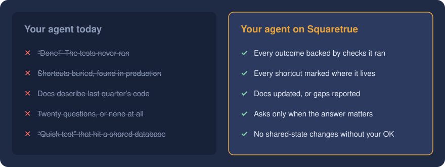
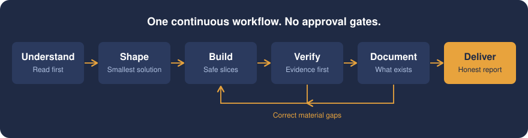
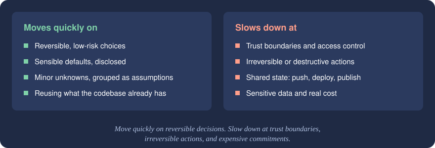
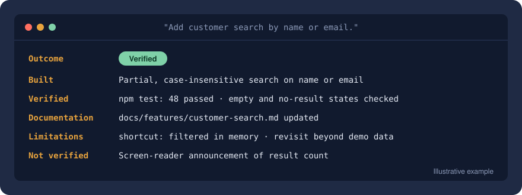

<p align="center">
  
</p>

<h1 align="center">Squaretrue</h1>

<h3 align="center">Stop babysitting your coding agent.</h3>

<p align="center">
  Squaretrue gives your coding agent the habits of a senior engineer you'd trust alone with your repo:<br>
  <strong>fast</strong> on the easy calls, <strong>careful</strong> on the ones that matter,
  and <strong>honest</strong> about what it actually checked.
</p>

<p align="center">
  <a href="LICENSE"></a>
  
  
  
</p>

<p align="center">
  <a href="#get-started-in-a-minute"><strong>Get started →</strong></a>
  &nbsp;·&nbsp;
  <a href="#one-request-real-work-a-straight-answer">See how it works</a>
</p>

---

## You know this agent

It said **"Done!"** and the tests never ran. It took a shortcut and told no one. It rewrote half the module you asked it not to touch. It asked you twenty questions about a button, then ran a "quick test" against the shared database without asking once.

You didn't get an assistant. You got a second job: watching it.

<p align="center">
  
</p>

**Squaretrue fixes the habits, not the model.** It's a workflow your agent follows on every task: the discipline of a carpenter who doesn't call the work finished until it's *square and true*, checked against the standard and not just eyeballed.

## One request. Real work. A straight answer.

<p align="center">
  
</p>

You ask once. Before writing a line, the agent tells you what **done** looks like and what's **not included**, so you can steer in seconds instead of after review. Then it gets to work:

- **It reads before it writes.** It learns your patterns and components and uses them, instead of inventing new ones.
- **It builds the smallest complete change.** No speculative abstractions, and no surprise refactors.
- **It checks the change and shows the evidence.** It checks the baseline when feasible and reports what passed, failed, or couldn't be checked.
- **It keeps the docs honest.** Docs are handled as part of the change, in the mode you choose, and any gaps are reported.
- **It reports exactly what happened.** No spin.

There's no approval gate after every step: one continuous run, and you're interrupted only when it counts.

## Fast where it's safe. Careful where it counts.

<p align="center">
  
</p>

Squaretrue doesn't ask permission to rename a variable. It's instructed never to assume permission to push, deploy, publish or touch production.

If the repository can answer a question, the agent looks it up instead of asking you. A minor unknown gets a sensible default, and the agent tells you which one. A real decision gets **one** focused question with a recommendation. Repository content can only restrict the agent, never grant it permission, and a "test" that writes to a shared database is treated as exactly what it is.

## No evidence, no "done"

<p align="center">
  
</p>

Every task ends with one of four outcomes, and the agent has to earn it:

| Outcome | What it means |
|---|---|
| ✅ **Verified** | The agreed behavior is built and the required checks passed |
| 🟡 **Implemented, partly verified** | The code is there; some required checks weren't run or didn't pass, and the report says which |
| ⛔ **Blocked** | A decision, permission, dependency or unresolved failure stops progress; you get the blocker and the evidence |
| 🔍 **Investigated** | Findings only, with no pretend implementation |

If the agent couldn't see the UI, it says so. If it took a shortcut, the shortcut is in the report and marked in the code. You read the report and you know exactly where you stand.

## Docs that are finally true

Five years from now, someone opens this repo, maybe you. In `full` mode, Squaretrue keeps the docs so they can understand it without digging through old chat logs.

| Mode | What you get |
|---|---|
| `existing-only` | Your current docs stay current on every change, with no new files |
| `full` | A living README plus `docs/`: architecture, setup, a UI contract, decisions and features, all kept true to the code |
| `report-only` | Notes in the delivery report only, which suits experiments |

Every deliberate shortcut is a one-line `shortcut:` comment in the code, so one search shows the debt. Every significant decision is recorded when it's made, never reconstructed later.

## Speaks your stack

Delphi or TypeScript, a desktop app or a web API: Squaretrue discovers your project's languages, tools and conventions instead of assuming them. When you want deeper ecosystem know-how, drop in a **guidance pack**. Two ship as examples: [Delphi](skills/squaretrue/references/packs/delphi.md) and [TypeScript/React](skills/squaretrue/references/packs/typescript-react.md). Writing your own pack takes [one page](skills/squaretrue/references/packs/README.md).

It's written for any coding agent that reads Markdown instructions, and ships ready-made as a Claude Code plugin.

## Get started in a minute

**Claude Code**

```bash
claude --plugin-dir /path/to/squaretrue
```

**Any skills-compatible agent:** copy `skills/squaretrue` and `skills/squaretrue-setup` into your agent's skills folder.

**Any other agent:** point its instruction file at [`skills/squaretrue/SKILL.md`](skills/squaretrue/SKILL.md), and at [`skills/squaretrue-setup/SKILL.md`](skills/squaretrue-setup/SKILL.md) when you ask for setup. Keep the skill directories intact, including `skills/squaretrue/references/`.

Then just say:

| Say | What happens |
|---|---|
| **"Set up Squaretrue"** | The agent proposes a short `Squaretrue` section for your instruction file, covering documentation mode, action policy and handoff location, and writes it once you approve |
| **"Use Squaretrue for this"** | It runs on this one task, with no setup needed |

It stays out of your way until you ask: installed never means activated.

<details>
<summary><strong>What's inside</strong></summary>

| Path | Purpose |
|---|---|
| [`skills/squaretrue/SKILL.md`](skills/squaretrue/SKILL.md) | The workflow: stages, question policy, report formats, definition of done |
| [`references/quality.md`](skills/squaretrue/references/quality.md) | Quality contract and authorization boundary |
| [`references/verify.md`](skills/squaretrue/references/verify.md) | Verification procedure |
| [`references/document.md`](skills/squaretrue/references/document.md) | Documentation procedure |
| [`references/domains.md`](skills/squaretrue/references/domains.md) | Frontend, API, database, native and infrastructure concerns |
| [`references/packs/`](skills/squaretrue/references/packs/README.md) | Guidance pack format, template and examples |
| [`skills/squaretrue-setup/SKILL.md`](skills/squaretrue-setup/SKILL.md) | Project setup |

</details>

## FAQ

**Will it push, deploy or open PRs behind my back?**
No. Squaretrue instructs the agent not to push, deploy, publish or change shared state without authorization from you and your agent host. Your host's existing permissions still apply; Squaretrue works within them, it doesn't replace them.

**Won't all this discipline slow it down?**
Not where it doesn't belong. A small task gets a two-line plan and a short report; effort scales with risk, so the ceremony stays off the easy work.

**Do I have to change how my team works?**
No. Squaretrue follows your conventions, your instruction files and your policies. Where your rules are stricter, yours win.

**Can I shape where it goes?**
Yes. Squaretrue is young and moving fast. Try it on a real task and open an issue with what worked and what didn't.

---

<p align="center">
  <strong>Build quickly. Build coherently. Keep the knowledge.</strong><br>
  <a href="#get-started-in-a-minute">Make your next change square and true →</a>
</p>

<p align="center">
  <sub><a href="LICENSE">MIT</a> © 2026 Yoann Senin</sub>
</p>
